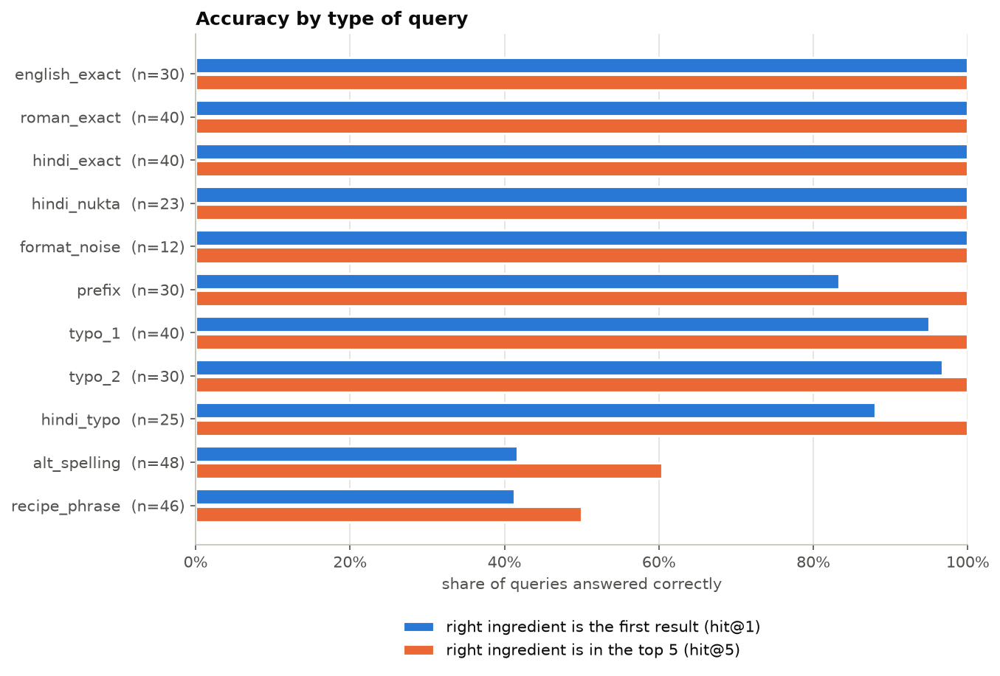
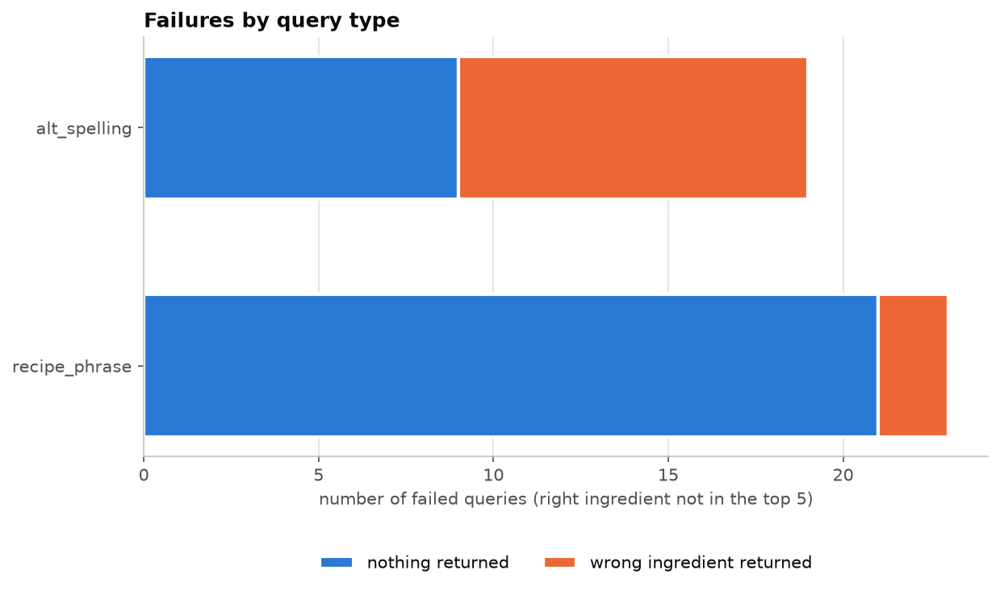
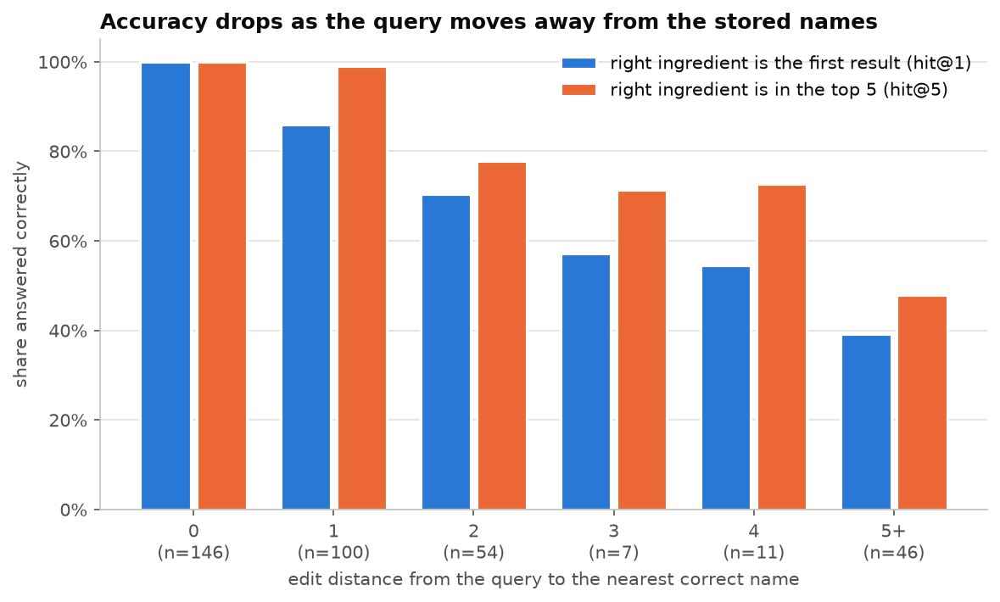
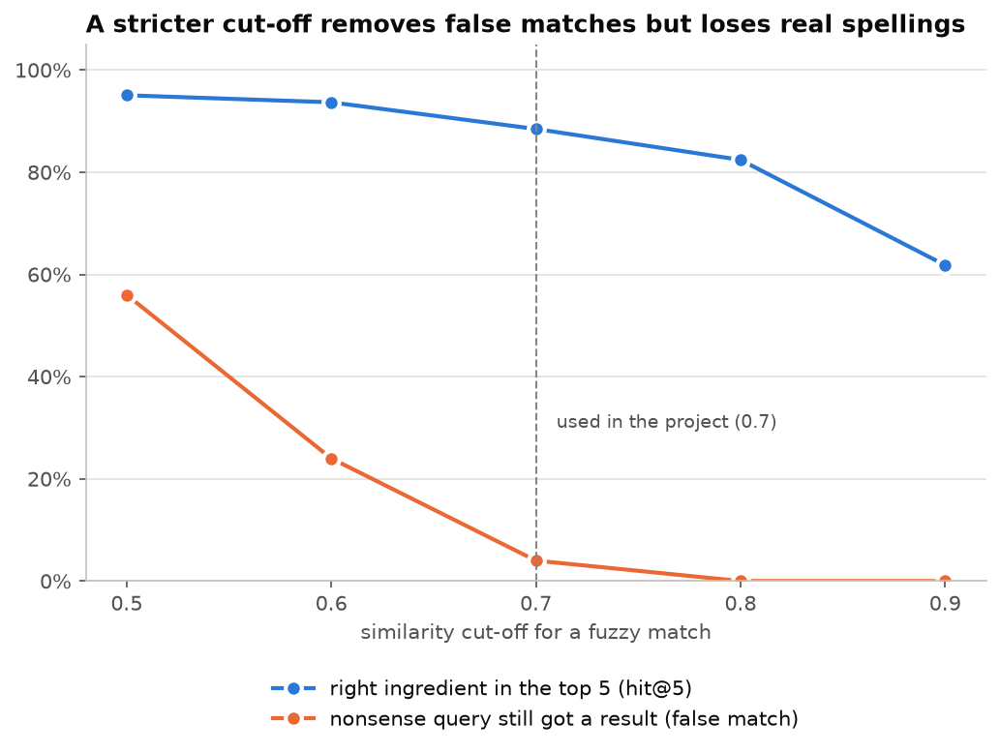
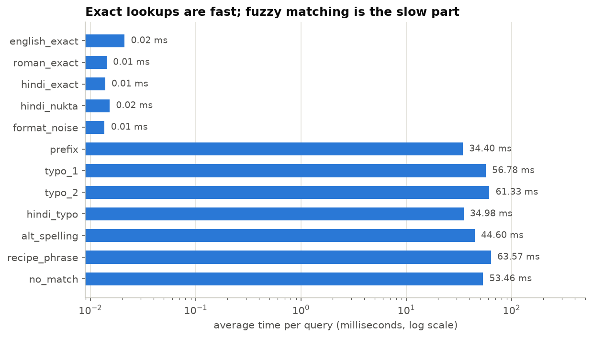
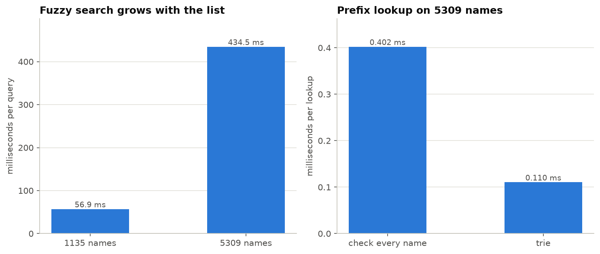

# CGAS Group 26: Multi-Language Search (Deliverable 2)

Team: Sarthak Aggarwal (MT26139) and Divyanshu Joshi (MT26120).

This part lets a user find an ingredient from the 250 in Deliverable 1 by typing an English name, a Roman spelling or a Hindi word, even with a spelling mistake. Typing `jeera`, `जीरा` or `cumin` all lead to the cumin rows. Deliverable 3 and 4 call it to turn what the user typed into an ingredient `index`.

## Files
The number in each name is the order to write and read them. A file only imports files with a lower number.

| Step | File | What it does |
|---|---|---|
| input | `D1_input_lookup_ingredient_250_final_dataset.csv` | The dataset, copied here unchanged; read by `D2_3_lookup.py` |
| input | `D1_input_make_test_queries_26_Assignment_3_raw_input.csv` | The 10,000 recipes; read by `D2_7_make_test_queries.py` for real recipe phrases |
| 1 | `D2_1_normalize.py` | Cleans text: lowercase, no extra spaces or punctuation, Hindi nukta and chandrabindu made uniform |
| 2 | `D2_2_levenshtein.py` | `edit_distance(a, b)`: number of single-letter changes between two words |
| 3 | `D2_3_lookup.py` | Reads the CSV and builds the exact-match table (a hash map) |
| 4 | `D2_4_trie.py` | Prefix tree for autocomplete and "starts with" search |
| 5 | `D2_5_search.py` | Joins the three steps and ranks the results |
| 6 | `D2_6_demo.py` | Prints example searches |
| 7 | `D2_7_make_test_queries.py` | Builds `D2_7_test_queries.csv`, the queries used to test the search |
| 8 | `D2_8_evaluate.py` | Runs the test queries and saves `D2_8_evaluation_results.csv` and `D2_8_evaluation_summary.csv` |
| 9 | analysis notebook | Charts from the saved results |

## How to run
Run from this folder, in the order below. Only Python 3 is needed for the search itself (use `python3` if `python` does not work on your computer). Python has no compile step, so each file is run directly.

1. Self-checks of the building blocks, in build order. Each prints `ok` or `FAIL`.
```
python D2_2_levenshtein.py
python D2_3_lookup.py
python D2_4_trie.py
```
`D2_1_normalize.py` and `D2_5_search.py` have no self-check of their own. `D2_6_demo.py` runs them (`D2_5_search.py` uses `D2_1` to `D2_4`), and `normalize()` can also be tried on its own:
```
python -c "from D2_1_normalize import normalize; print(normalize('  Jeera! '))"
```
2. Demo.
```
python D2_6_demo.py
python D2_6_demo.py haldi जीरा turmaric
```
3. Build the test queries, once. It rebuilds the test file, so do not run it again after editing `D2_7_test_queries.csv` by hand.
```
python D2_7_make_test_queries.py
```
4. Run the evaluation. It saves `D2_8_evaluation_results.csv` and `D2_8_evaluation_summary.csv`.
```
python D2_8_evaluate.py
```
5. Charts: open `D2_9_analysis.ipynb` with `jupyter notebook` and choose Run All. It reads the saved results, so do step 4 first. The notebook also needs pandas and matplotlib.

In code:
```python
from D2_5_search import IngredientSearch
engine = IngredientSearch()
engine.search("zeera", top_k=5)   # list of matches, best first
engine.suggest("jee")             # English names for an autocomplete box
```
Each match is a dict with `index`, `english_name`, `hindi_name`, `score` (0 to 1), `match_type` (`exact`, `prefix` or `fuzzy`) and `matched_name`. An empty list means no match.

## How the search works
The query is cleaned with `normalize()`, then:

1. **Exact:** the cleaned query is looked up in a hash map of every English, Roman and Hindi name. Score 1.0.
2. **Prefix:** the trie finds every name that starts with the query. Score = 0.6 + 0.3 x (query length / name length), so a longer typed part scores higher. Needs 2 or more letters.
3. **Fuzzy:** only when there is no exact match. The query is compared with every name, and with each single word of a name when one word was typed, using Levenshtein distance. Similarity = 1 - distance / longer length. Matches below 0.7 are dropped. Score = 0.6 x similarity. Needs 3 or more letters.

An ingredient found in more than one way keeps its best score. Results are sorted by score, then by name.

## Results
We ran 389 test queries of 12 types (`D2_7_test_queries.csv`). 364 of them have a correct ingredient; the other 25 are words that are not in the dataset, and the search should return nothing for them. **Hit@1** means the right ingredient is the first result, **Hit@3** and **Hit@5** mean it is in the top 3 or top 5, and **MRR** is the average of 1 / rank of the right ingredient (0 when it is missing).

| Query type | n | Hit@1 | Hit@3 | Hit@5 | MRR | Mean ms |
|---|---|---|
| english_exact | 30 | 1.00 | 1.00 | 1.00 | 1.00 | 0.02 |
| roman_exact | 40 | 1.00 | 1.00 | 1.00 | 1.00 | 0.01 |
| hindi_exact | 40 | 1.00 | 1.00 | 1.00 | 1.00 | 0.01 |
| hindi_nukta | 23 | 1.00 | 1.00 | 1.00 | 1.00 | 0.02 |
| format_noise | 12 | 1.00 | 1.00 | 1.00 | 1.00 | 0.01 |
| prefix | 30 | 0.83 | 1.00 | 1.00 | 0.91 | 34.40 |
| typo_1 | 40 | 0.95 | 1.00 | 1.00 | 0.98 | 56.78 |
| typo_2 | 30 | 0.97 | 1.00 | 1.00 | 0.98 | 61.33 |
| hindi_typo | 25 | 0.88 | 1.00 | 1.00 | 0.94 | 34.98 |
| alt_spelling | 48 | 0.42 | 0.58 | 0.60 | 0.50 | 44.60 |
| recipe_phrase | 46 | 0.41 | 0.50 | 0.50 | 0.45 | 63.57 |
| **All 364 with an answer** | 364 | 0.82 | 0.88 | 0.89 | 0.85 | 30.46 |

Of the 25 words that are not in the dataset, 24 returned nothing (rejection rate 0.96). The one that did return a result was `paprika`, which matched `papaya`.



### What we saw
- **Names from the dataset** (English, Roman, Hindi, Hindi without the nukta, and changed case or spacing; 145 queries) all gave the right ingredient first.
- **Typos** did well: Hit@1 was 0.95 with one wrong letter, 0.97 with two, and 0.88 for Hindi words with a letter dropped. In every typo and prefix group the right ingredient was always inside the top 3.
- **Where the first results came from.** 298 queries got the right ingredient first: 146 through an exact match, 115 through a fuzzy match and 37 through a prefix match.
- **Alternative Roman spellings** (hand-written, not stored in the dataset) got the right ingredient first for 20 of 48 queries, and in the top 5 for 29 of 48. `sabu dana` works because it is one space away from the stored `sabudana` (similarity 0.89), and `adrak` is found through the stored names that start with it. `jira`, `zira`, `lasan`, `lavang`, `nimboo` and `dahee` returned nothing, and `mutter`, `kajoo` and `heeng` returned `butter`, `dates` and `prawns`. Of the 19 spellings that missed, 9 returned nothing and 10 returned a wrong ingredient.
- **Recipe phrases** (taken from the recipe file) got the right ingredient first for 19 of 46 queries and in the top 5 for 23 of 46. 21 of the 23 misses returned nothing. For example, `spring onion greens` and the stored `spring onion` have a similarity of 0.63, just under the 0.7 cut-off.



- **Distance from the stored name.** The further a query is from the nearest correct name, the less often it is found. The edit distance is the number of single-letter changes.

| Edit distance | Queries | Hit@1 | Hit@5 |
|---|---|---|
| 0 | 146 | 1.00 | 1.00 |
| 1 | 100 | 0.86 | 0.99 |
| 2 | 54 | 0.70 | 0.78 |
| 3 | 7 | 0.57 | 0.71 |
| 4 | 11 | 0.55 | 0.73 |
| 5 or more | 46 | 0.39 | 0.48 |



- **The 0.7 cut-off.** We ran the same queries with the fuzzy cut-off from 0.5 to 0.9. A lower cut-off finds more right answers but lets more nonsense words through; a higher one does the opposite.

| Cut-off | Hit@5 | Nonsense words that still got a result (of 25) |
|---|---|---|
| 0.5 | 0.95 | 14 |
| 0.6 | 0.94 | 6 |
| **0.7 (used)** | 0.89 | 1 |
| 0.8 | 0.82 | 0 |
| 0.9 | 0.62 | 0 |



- **Speed.** Exact lookups take about 0.01 to 0.02 ms. Every query that goes through fuzzy matching takes 35 to 64 ms. On a list of 1,135 names fuzzy search took 57 ms per query, and on a list of 5,309 names it took 435 ms. For prefix lookup on 5,309 names the trie took 0.11 ms against 0.40 ms for checking every name.




## Notes
- One Hindi name can belong to two rows (`जीरा` is both cumin seeds and cumin powder), so a search can return several indexes for one name.
- Evaluation results are in the analysis notebook once `D2_8_evaluate.py` has been run.
- **Fuzzy matches compare letters, not meaning.** This helps with near spellings and hurts with unfamiliar words. `bhendi` (the Marathi word for okra) finds okra, but only because it is one letter away from the stored `bhindi`. In the same way a short unfamiliar word can land on the wrong ingredient: `kanda` (onion) returned eggs, and `mirchi` returned black pepper corns. Each result carries a `score` and a `match_type` (`exact`, `prefix` or `fuzzy`), and a fuzzy result always scores lower than an exact or strong prefix match, so an app built on this should show the match type and let users see when the search is guessing. This is a known limit of the current version.
